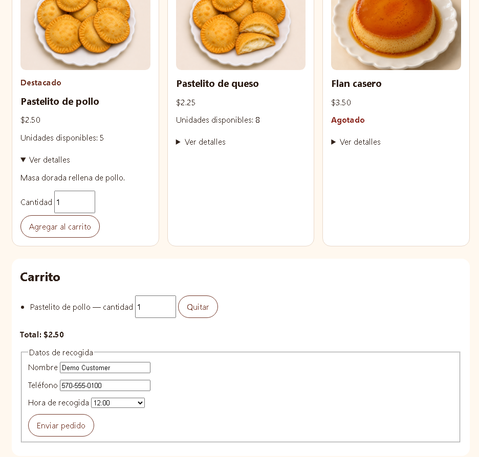
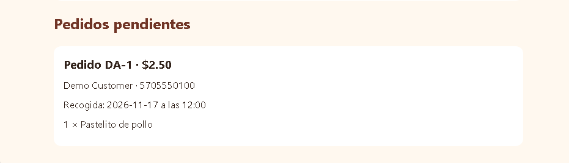

# Doña Ana

A Spanish-language web app for a home food business. Customers browse available
dishes, choose a pickup date and time, and submit a pending order. The owner
can manage the menu and view pending orders.

## Local setup

1. Install Node.js 24 and clone this repository.
2. In the project folder, run `npm ci`.
3. Set `OWNER_PASSWORD` in the server environment to enable owner sign-in.
   Use a private password of at least 16 characters.
4. Run `npm start`. In Windows PowerShell, use `npm.cmd` if `npm` is blocked.
5. Open `http://localhost:3000/` for the menu or `/owner.html` for the owner panel.

## How to use it

- Customer: Choose an open date, add dishes, adjust quantities, and submit the
  order with contact information and a pickup time. Save the order number.
- Owner: Sign in to view pending orders and create, edit, or archive dishes.
  The editor accepts JPG, PNG, and WebP photos up to 4 MB.

## Architecture and tests

The application uses HTML, CSS, and JavaScript with Express and SQLite. It
follows an MVC-style structure. Views render the interface, controllers handle
requests, services validate the cart, and repositories manage storage. Orders
and their inventory deductions are saved in one SQLite transaction.

Run `npm test -- --runInBand` to check totals, price changes, and invalid
quantities. Manual smoke tests cover pickup dates, order submission and retry,
and owner sign-in and menu management.

## Deployment and troubleshooting

- Build: `npm ci`
- Start: `npm start`
- Health check: `/health`
- `PORT` defaults to 3000 locally. Set a different port if 3000 is in use.
- `DATA_DIR` defaults to `data/`. Set it to a writable persistent directory
  on the host to keep orders, menu edits, and uploaded photos across deploys.
- If owner access is unavailable, check `OWNER_PASSWORD` and restart the server.

## MVP limitations

The app uses demo pickup hours and records orders as pending and unpaid.
Payments, customer search, and a private order-status page are planned for
a later sprint. Use fictional customer information in the public demo.

## Live demo

[Open Doña Ana](https://dona-ana.onrender.com/)

### Customer menu and cart

### Owner panel and pending orders

